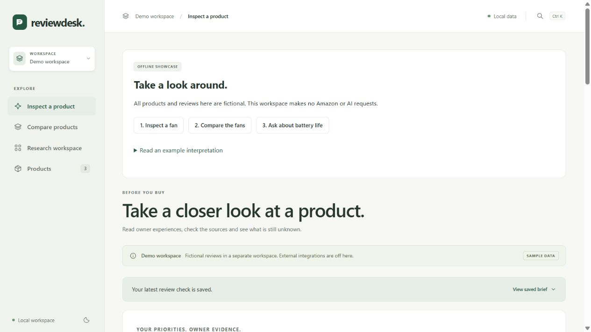
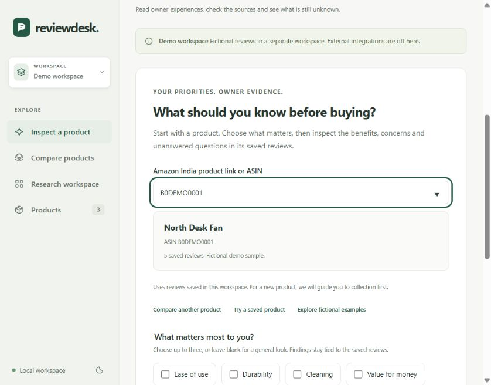

# Reviewdesk

A local workspace for inspecting product reviews, comparing owner experiences and checking the evidence behind an AI answer.

The project started as an Amazon India review scraper. It now keeps collection progress, stores reviews in SQLite, runs background jobs and produces reports with source links. AI interpretation is optional. Counts, ratings and review search work locally.



## Try it without an account or API key

Use Python 3.10 or newer. From the project folder:

```console
python showcase.py
```

Open [the offline showcase](http://127.0.0.1:8766). It creates a separate workspace with 15 fictional reviews for three named desk fans. The guide lets you inspect a product, compare two fans and ask about the saved reviews. Collection and external AI are disabled, including on the server. Environment keys and saved credentials are not loaded.

The example interpretation is a written walkthrough, clearly labelled as such. It is not a recorded or live model answer. Stop the server with Ctrl+C; restarting keeps the showcase data and saved runs.

For your own workspace, run `python dashboard.py`. Live collection additionally needs the dependencies in `requirements.txt`, Chromium and a manually saved Amazon session. See [the usage guide](docs/USAGE.md).

## What is worth exploring

- **Inspect a product:** choose priorities, read the saved evidence and open the original reviews.
- **Compare products:** validate two links, reuse saved reviews and collect only a bounded shortfall when requested.
- **Ask about reviews:** exact count and rating questions stay local. Other questions retrieve excerpts before optional AI interpretation. Explicit variant questions disclose which review descriptions qualified and which were excluded.
- **Follow a run:** expand its execution history to see recorded stages, timings, request counts and recovery outcomes.
- **Check a claim:** accepted AI passages resolve to stored source text. A matching quote establishes traceability, not whether the interpretation is correct.



## Engineering choices

Python serves a loopback-only API and one background worker. Playwright owns the authenticated collection session. SQLite stores reviews, checkpoints, jobs and validated AI cache entries. The interface uses local HTML, CSS and JavaScript, with separate inspection, comparison and shared presentation modules.

A job can stop, keep its saved work and resume through a new request. Cache identities include the source data and relevant analysis settings. Provider requests have budgets, timeouts, free-only routing and local response checks. A rejected answer leaves labelled local evidence available.

[Architecture and data flow](docs/ARCHITECTURE.md) · [Design decisions](docs/DECISIONS.md)

## Verification

```console
python -m unittest discover -s tests -v
python tools/check_web.py
python -m evaluations.run --output evaluation-report.json
```

To run the headless browser journeys:

```console
python -m pip install -r requirements.txt
python -m playwright install chromium
python -m unittest discover -s browser_tests -v
```

The browser tests use fictional reviews, fake providers and isolated storage. They block external browser requests. CI exercises the Python suite on Windows and Linux, plus Chromium journeys for inspection, comparisons, sources, export, cache reuse, cancellation, provider failure and keyboard navigation.

The synthetic evaluation currently passes 4 statistics cases, 8 source-validation cases and 20 of 20 retrieval cases, including explicit variant scope and selected word forms. These are small authored regression cases, not a general retrieval benchmark. These results do not measure LLM interpretation accuracy. A separate opt-in runner can collect real answers for selected fictional cases, with human review left pending. [Evaluation method and results](evaluations/README.md).

## Limits and project status

This is a local, single-user portfolio project. Public hosting is deferred. Amazon can restrict accessible reviews or require manual sign-in. Collected reviews are a sample, and different variants can share reviews. Free AI endpoints can be unavailable or rate-limited; deeper live agent research remains unverified. The app does not establish current prices, detect fake reviews or calculate a universal best product.

Development used AI assistance. The repository documents the design, checks and remaining gaps so the implementation can be reviewed and explained. There is no claim that automated checks replace human review.

[Two-minute walkthrough](docs/WALKTHROUGH.md) · [Interview notes](docs/INTERVIEW.md) · [Release status](docs/RELEASE.md) · [Usage guide](docs/USAGE.md)
