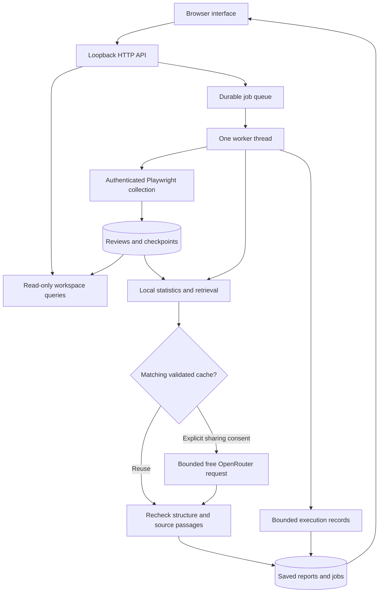
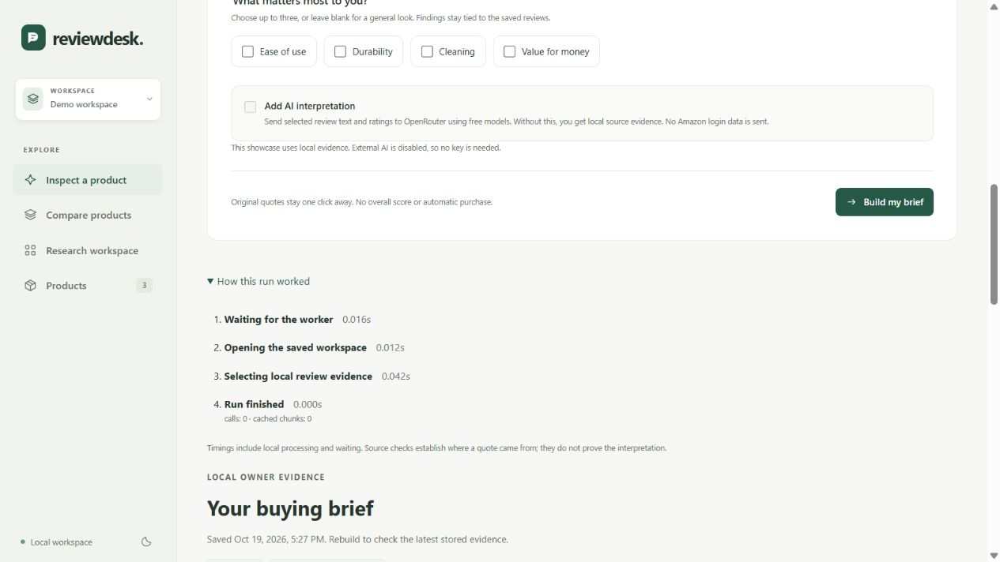

# Architecture

Reviewdesk runs on one machine for one user. Its useful boundary is a saved review workspace: collection adds evidence, local code computes facts, and optional AI interprets selected text.

## Responsibilities

| Area | Files | Responsibility |
| --- | --- | --- |
| HTTP boundary | `dashboard.py`, `dashboard_data.py` | Request guards, explicit static assets, scoped queries and CSV transfers |
| Job lifecycle | `job_manager.py`, `execution_trace.py` | One queued worker, cancellation, restart handling and recorded stage transitions |
| Collection | `collection_runtime.py`, `collector.py`, `review_parser.py` | Session reuse, bounded navigation, parsing and checkpoints |
| Storage | `review_store.py`, `analysis_store.py` | Transactions, deduplication, source metadata, request ledger and cache |
| Analysis | `review_analysis.py`, `review_evidence.py`, `research.py`, `buying_brief.py`, `product_comparison.py` | Local facts, selected context and separate analysis workflows |
| Model boundary | `llm_provider.py`, `provider_errors.py`, `credential_store.py` | Fixed provider destination, free routing, safe errors and optional Windows key storage |
| Interface | `web/app.js`, `web/ui/` | Workspace coordination, separate inspection and comparison features, shared DOM and execution rendering |
| Reproducible checks | `evaluations/`, `browser_tests/`, `tests/` | Synthetic retrieval scenarios, actual browser journeys and backend tests |

## Where AI participates

Collection does not use an LLM to navigate Amazon. Rating statistics and lexical retrieval also stay local. Focused research and comparisons normally need one optional interpretation request. Deeper research can let a model choose from a small read-only tool set, with limits on tools, calls and elapsed time. Its live provider reliability is still unresolved.

Review text is untrusted input. It can contain commands, mistakes and personal information. The app passes bounded text and opaque evidence labels, then rejects unavailable citations or invalid output. Source matching does not establish semantic entailment; that distinction is visible in the evaluation and interface.

## Persistence and interruption

Review rows and collection checkpoints are committed durably. Reports and jobs live in the jobs database; validated chunks and request attempts live in a separate analysis database. Cancelling a run keeps completed work. A restart marks unfinished jobs interrupted and requires an explicit new job.

Execution records are versioned JSON inside the existing job progress column. Their public representation includes phases, timestamps and allowlisted counters. It excludes prompts, answers, credentials and session contents. At most 32 transitions are retained, with a disclosure when intermediate transitions are omitted. Historical jobs have no invented trace. A restart cannot determine when the previous process stopped, so the last active step's duration is left unknown.

## Offline showcase boundary

`showcase.py` seeds a separate, marked data folder and starts the ordinary interface with a restricted service. It rejects collection, authentication, workspace jobs and external AI requests before enqueueing them. The provider registry ignores environment keys and has no credential store. A nonempty folder without the showcase marker is refused.

The written example is served separately from job results. It never masquerades as a successful model call. Browser tests exercise the real HTTP and worker paths with fictional fixtures; provider responses are injected in-process.
