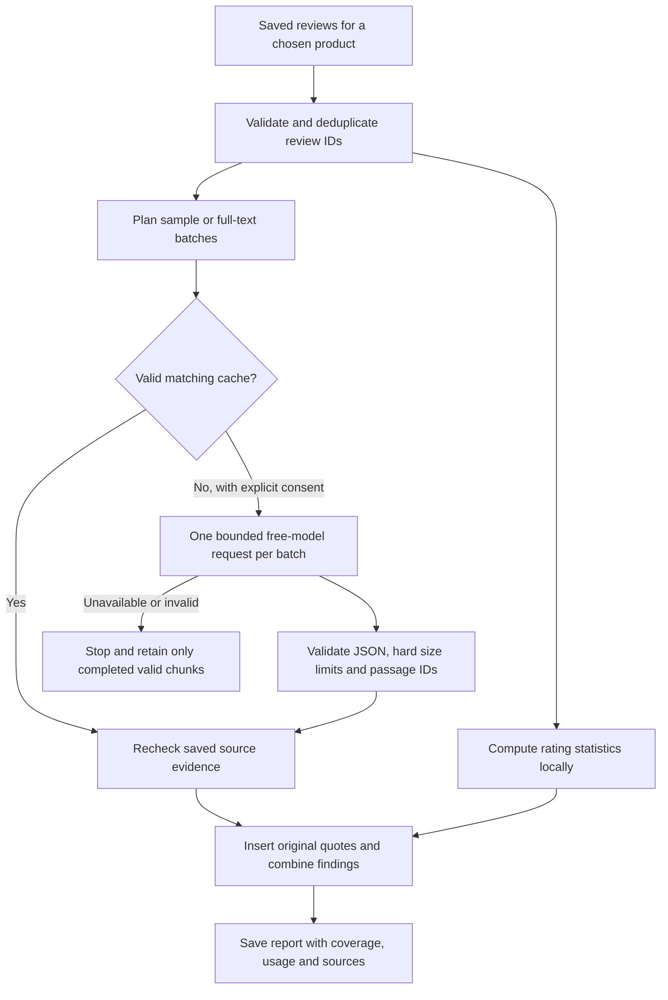

# Release status

Reviewdesk is a local research application for one user and one worker per data folder. It supports resumable collection, review browsing, local topic scans and optional free OpenRouter reports. It is suitable for demonstrating those workflows with their limits disclosed. It is not ready to expose as a multi-user website.

The intended product direction is a hosted app that anyone can use. See the [public beta plan](HOSTED_BETA.md). This document describes what the current release can support, rather than claiming those hosted features already exist.

## What has been checked

- Live collection saved more than 5,000 distinct review IDs across multiple products. The largest observed count for a single product was 100. This is an observed result, not a universal collection limit.
- One live ten-review OpenRouter report completed, passed local validation, saved and displayed its sources. The provider reported $0.00. That result establishes one successful small run, not a reliability guarantee.
- A broader 100-review plan included all stored text in one request. Its live attempt received HTTP 404 and saved no AI report. The app retained the failure without retrying, paying for another route or relaxing privacy.
- Local statistics and keyword reports work independently of provider availability.
- Compatible JSON mode does not require native provider JSON support, while retaining local format and source validation. Provider-enforced JSON is an explicit alternative. Fictional-response tests cover both modes, cache isolation, exact encoded request sizing, safe routing categories and rejection of unavailable source passages.
- A later compatible-mode 100-review request reached Cohere and returned a complete response at a reported cost of $0.00. Local citation validation rejected it, so it did not produce an accepted AI report. The saved historical error cannot distinguish an unknown passage from duplicate evidence.
- The engine preserves distinct exact excerpts from one review under a single source and counts its review and rating once, including across long-review segments and cached results. Unknown labels, repeated labels and altered quotes still fail validation.
- Citation diagnostics retain only fixed reason codes without storing the rejected answer. OpenRouter I/O logging is a separate, optional account setting that stores future prompts and answers; enabling it cannot recover a past response.
- The engine separates short writing preferences from the hard report limits documented in the README. Exact source checks and the 1,000-token output ceiling remain in force.
- A live compatible-mode 100-review report on engine 8 completed in about 26 seconds using one request, with 12,276 input tokens, 690 output tokens and a provider-reported cost of $0.00. It covered all 103 stored text segments, saved and displayed six themes. Every displayed passage was checked against its stored source, and each theme's cited review and rating counts matched distinct source IDs. Some model interpretations and selected snippets still need human review; source matching does not prove semantic support or topic prevalence.
- Optional Windows Credential Manager storage restores a remembered key and its AI preferences after restart. Synthetic tests cover opt-in, opt-out, replacement, restoration, forgetting, failed writes and unreadable entries. A real Windows vault round trip is tested separately with a unique synthetic credential and cleanup. The sidebar exposes the last checked provider allowance separately from local accounting.
- Research now retrieves related passages locally before optional interpretation. Focused answers use at most one model request, with source-checked cache reuse. The deeper tool agent is an explicit option. A provider or validation failure returns labelled local evidence, not an accepted AI answer. Durable rate-limit backoff prevents repeated attempts during the wait. A live price question searched 100 stored reviews, selected 12 excerpts and returned a source-checked answer in one request, with 2,169 input tokens, 164 output tokens and a provider-reported cost of $0.00. Its interpretation still needs human review. The interface labels sampled context and AI interpretation, and price questions always disclose that reviews do not establish current market prices.
- Repeating that live research question after restarting the server reused the revalidated answer with zero new model calls. The remembered key also restored without re-entry. Local-only retrieval returned related source excerpts without contacting a model.
- Product inspection now includes saved names with secondary ASINs, library search and sorting, source names, critical-review filtering and direct links to product-scoped findings and questions. Editable local labels survive lower-priority title refreshes. Supported collection pages capture product titles; dashboard CSV import and export preserve an optional product_name column. Schema 2 adds metadata without changing review or checkpoint records. Older databases remain readable without migration in read-only mode.
- Browser checks cover name and ASIN search, an empty-search recovery, alphabetical sorting, critical-review filtering, saved-report navigation and product-scoped questions. Name editing and persistence after reload were checked in an isolated fictional workspace. Existing workspace names were restored from earlier product research by exact ASIN; they remain editable labels, not a guarantee about the current listing or its variants. Review and checkpoint contents were verified unchanged after the backed-up metadata migration.
- All 337 automated tests pass, with the real Windows vault check skipped by default and verified separately. Tests use fictional reviews and fake model responses. They cover product metadata migration and transaction rollback, name priorities, CSV name transfers, search, request guards, pagination recovery, cancellation, validation, privacy boundaries, cache reuse and request budgets. CI runs on Windows and Linux with Python 3.10 and 3.13.

Live collection pins Playwright to the version used in this workspace. The offline app needs only Python's standard library. Recheck the pinned dependency and its browser build before a release; a pin makes updates deliberate, not permanently safe.

Live tool-agent retrieval and a full-library LLM report remain unverified. A successful model response does not establish that every interpretation is correct.

## The analysis flow



For 100 stored reviews, broader coverage can fit in one batch. Long reviews are split without discarding text. The model is asked for three themes and two passages per theme, with hard limits of eight themes and eight passages. Reading all text does not mean every issue will appear in the summary. Theme counts show distinct cited reviews, not measured prevalence. Multiple passages from one review count once. Rating statistics cover the selected stored collection independently of text coverage.

The scraper does not use an LLM to navigate Amazon. Research retrieves locally first and normally uses one optional interpretation call. The bounded tool agent is selected explicitly for deeper investigation. Recognized count and rating questions stay local. More agents do not automatically improve either workflow.

## Verify a release

Run from the repository folder:

```powershell
python -m unittest discover -s tests -v
node --check web/app.js
python offline.py demo --db data/demo.sqlite3
python dashboard.py
```

Use the fictional dataset for a public recording. Confirm navigation, review search, source drawers and the report explanation panel. Test collection only when you intend to contact Amazon. An AI acceptance check requires explicit review-sharing consent and an available compatible free model; do not treat offline model fixtures as live results.

Before sharing source, inspect the proposed Git changes. Exclude session files, keys, collected datasets, databases, logs and backups. Do not publish a real-data screenshot without reviewing its visible review text and author fields. The repository's fictional examples can be demonstrated without an Amazon account or API key.

## Recovery

Use **Stop job** and let the job settle before stopping the server. Once the process exits, back up the complete data folder, including any SQLite sidecar files, to a private location. Keep the Amazon session file separate and private. Restore a backup only while the server is stopped. A restored request ledger is not an authoritative view of the provider's current allowance; check the account quota before starting new model work.

Saved reviews, reports and validated chunks survive restart. Unfinished jobs are marked interrupted and require an explicit new run. A session-only API key is intentionally lost when the process exits. On Windows, an explicitly remembered key and its AI preferences are restored from Windows Credential Manager. A server without saved preferences defaults to requiring zero data retention. Backing up the data folder does not export the remembered credential.

## Before public hosting

The current `http.server` implementation remains bound to loopback. Python explicitly advises against using that server for production hosting: [Python HTTP server documentation](https://docs.python.org/3/library/http.server.html).

A hosted release needs a supported application server, HTTPS, user authentication, authorization for every dataset and job, isolated user storage and secrets, per-user quotas, durable workers, migrations, backup restoration checks and operational monitoring. The Amazon browser session also needs an isolated lifecycle per user. Changing the bind address or adding a tunnel does not provide these boundaries.

Free model capacity is not a service-level guarantee. Keep the local report available when no route qualifies. Do not market the current application as collecting every Amazon review, detecting fake reviews, or providing guaranteed free AI availability.
