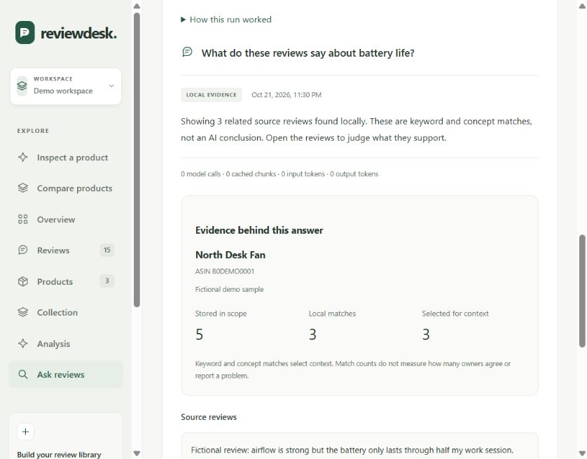

# Selecting evidence before an answer

Focused research first selects saved review text locally. An optional model then interprets that selection. Better generation cannot recover a relevant review that never reached the model, so selection has its own checks.

## Word forms without substring matching

The question "Does it overheat?" should find "No overheating in my use." Negative experiences and reports of no issue are both relevant; retrieval does not decide sentiment.

Small, explicit word families connect `overheat`, `overheats`, `overheated`, `overheating` and the equivalent forms of `leak`. Whole-word matching keeps unrelated terms such as `heater` out. Excerpt selection anchors on the original matched word, including in long reviews. The app preserves source text rather than stemming the displayed quote.

This vocabulary is intentionally limited. It does not provide general morphology, translation, semantic search or an exhaustive synonym dictionary.

## Variant identity is a separate condition

For an explicit question such as "Does the blue variant overheat?", topic matching happens after checking the recognized variant description. A mention of blue alone must not count as evidence about overheating.

Supported scope uses explicit English color, capacity and size phrases, including equivalent capacities such as `500 ml` and `0.5 litre`. Review descriptions with missing or conflicting identity are excluded. Mixed descriptions and unresolved requests produce uncertainty, rather than an assumed identity. Quantities used to describe an activity, such as blending 500 ml of milk, do not automatically become product variants.

The saved scope records eligible reviews before topic matching, exclusions with unknown identity, and exclusions with conflicting or ambiguous descriptions. It also retains bounded exact identity passages for the selected sources. The interface exposes those passages separately from topical evidence so a reader can inspect why a review qualified.

These are descriptions in review text, not verified purchase attributes. The parser recognizes a narrow grammar. Unsupported attributes, languages and phrasing can remain unfiltered or be missed. Conservative exclusions can discard useful accounts. Unscoped questions still search relevant accounts across variants. The deeper agent workflow does not inherit this focused filter and has a separate availability limitation.

## Three counts with different meanings

- **Stored in scope:** distinct reviews available to this saved question.
- **Local matches:** reviews matching the recognized scope and lexical topic.
- **Selected for context:** up to twelve reviews whose bounded excerpts are made available for interpretation.

None measures how often a defect occurs. The local fallback can display fewer source passages than were selected, and an AI answer can cite only some supplied passages. The source drawer opens the original stored review.



## Checking a change

```console
python -m unittest tests.test_retrieval_forms tests.test_retrieval_variants -v
python -m evaluations.run --output evaluation-report.json
```

Unit tests cover exact source preservation, original IDs staying out of model input, word boundaries, negation, conflicts, aliases and excerpts. The synthetic evaluation has 32 authored scenarios: four statistics, eight source-validation and twenty retrieval cases. Its reference notes still need independent human review. Passing these cases does not measure model interpretation accuracy or establish general retrieval performance.

The focused research cache version changes when these selection rules change. Cache reuse still checks current evidence and policy; an answer accepted under older selection rules is not silently treated as a new result.

Focused responses can repeat the same passage label. The app collapses exact repeated source-and-quote pairs locally before validation, records that normalization in the research steps and keeps the eight-label input bound. Unknown labels, altered text and invalid answer structure are still rejected. Separate reviews with identical wording remain separate sources. A fake-provider test verifies acceptance, caching and zero additional requests for this recovery; the core source validator remains strict.

## Walk through the code

Start with `_terms`, `_variant_scope` and `retrieve` in `research.py`. Follow a local question into `_local_result`, then inspect the optional provider branch in `ask_reviews`. Explain why each exclusion happened and which exact text reached the model. For an interview, change one fixture and predict the result before running it.
